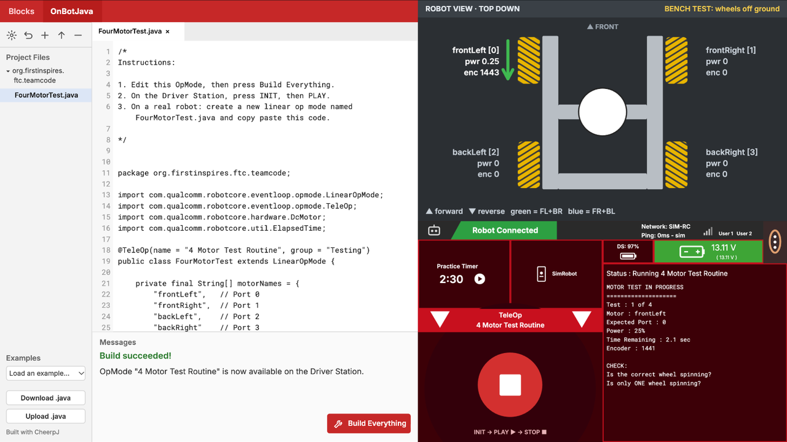

# FTC OpMode Sim (web)

A p5.js web sketch that lets students write and run real FTC SDK OpMode code in the browser and watch a 2D simulation of their robot, before they ever touch real hardware. Nothing to install.

Students write the same Java they would put on a real robot. The code they write in the sim pastes onto a real robot unchanged.

This is the web version of the [FTC OpMode Sim Processing sketch](https://github.com/theantonius/ftc-opmode-sim).



## What's in the window

- **Editor (left):** an OnBot Java-style editor. Type your OpMode, press **Build Everything**, and see "Build succeeded!" or compile errors with line numbers. Click an error to jump to its line.
- **Robot view (top right):** a top-down mecanum chassis on a bench (wheels off the ground). Each wheel shows its name, port, power, encoder count and a spin arrow. The center circle shows the robot's direction for the 10 standard mecanum moves.
- **Driver Station (bottom right):** modeled on the real Driver Station. Press INIT → PLAY → STOP and read live telemetry (scroll it with the mouse wheel).

## Features

- Real FTC SDK code: `LinearOpMode`, `@TeleOp` / `@Autonomous`, `hardwareMap`, `DcMotor`, `telemetry`, `ElapsedTime`
- Real Java compiler errors, compiled in the browser
- Four drive motors, fixed configuration: `frontLeft` (0), `frontRight` (1), `backLeft` (2), `backRight` (3)
- Real motor mirroring: left motors spin backward at positive power until you call `setDirection(DcMotor.Direction.REVERSE)`
- Simulated encoder counts
- Real Driver Station error when a hardware name is wrong
- A loop that ignores STOP can't freeze the page: after 5 seconds the Driver Station reports the code is stuck and stops it
- Your OpMode is saved in your browser automatically. **Download .java** saves it for a real robot; **Upload .java** opens a file.
- Example OpModes in the **Examples** menu: 4 Motor Test, 4 Motor Test with compile errors, a stuck `while (true)` loop, and Mecanum Patterns

## Run it locally

You need Python 3 (included with macOS developer tools) and git.

```
git clone https://github.com/theantonius/ftc-opmode-sim-web.git
cd ftc-opmode-sim-web
python3 tools/serve.py
```

Then open http://localhost:8080/ in Chrome. Press Ctrl+C in the terminal to stop.

Use `tools/serve.py`, not `python3 -m http.server`: the Java runtime needs a server that supports HTTP Range requests. Opening `index.html` as a file does not work.

The first visit downloads the Java runtime and takes about 10 seconds; after that it loads in a few seconds.

## Browser support

- Chrome on Mac: tested
- Safari on Mac: works; STOP can be slower when the window is in the background
- Firefox, Chrome on Windows and Chromebooks: expected to work, not tested yet
- Desktop browsers only (no phones or tablets)

## School networks

The page loads the Java runtime from **cjrtnc.leaningtech.com** (the CheerpJ CDN). School web filters must allow that domain. Everything else (p5.js, fonts, the editor) is served with the page.

## Writing your own OpMode

- The sim runs one OpMode: the file in the editor.
- The public class name must match the file name (for example `FourMotorTest` in `FourMotorTest.java`). The file name follows the class name.
- The name on the Driver Station comes from `@TeleOp(name = "...")` or `@Autonomous(name = "...")`.
- Build Everything compiles on Java 17. OnBot Java on a real robot is Java 8, so avoid newer Java features (such as `var`).

## Project layout

```
web/                      the site (published to GitHub Pages)
web/js/                   p5.js sketch, editor, Java bridge
web/sim.jar               the simulator (Java), run in the browser by CheerpJ
web/opmodes/              example OpModes
java/src/com/qualcomm/... FTC SDK stand-ins (same package names as the real SDK)
java/src/org/firstinspires/...
java/src/org/nycfirst/opmodesim/     the simulator, shared with the Processing sketch
java/src/org/nycfirst/opmodesimweb/  web-only bridge
tools/serve.py            local test server
tools/build-jar.sh        rebuilds web/sim.jar (needs JDK 17+)
tools/editor-bundle/      rebuilds web/vendor/codemirror.js (needs Node.js)
spike/                    Step 1 test page (CheerpJ check)
```

## Credits

- Built with [CheerpJ](https://cheerpj.com/) by Leaning Technologies, which runs the Java simulator and compiler in the browser. Used under the CheerpJ Community licence (free for educational use and non-commercial open source; loaded from the CheerpJ CDN). Uses that need a commercial licence or self-hosting are covered by Leaning Technologies' paid licences.
- [p5.js](https://p5js.org/) (LGPL-2.1), bundled in `web/vendor/`
- [CodeMirror](https://codemirror.net/) (MIT), bundled in `web/vendor/`
- Fonts: Inter and Roboto Mono (SIL Open Font License; license files next to the fonts)

## License

Copyright (c) 2026 Antonius Wiriadjaja. Licensed under LGPL-2.1. See [LICENSE](LICENSE).

## About

Built by Antonius Wiriadjaja at NYC FIRST for robotics education.

FIRST® and FIRST® Tech Challenge are trademarks of FIRST. REV Robotics is a trademark of REV Robotics. This is not an official FIRST or REV Robotics product. The FTC SDK classes in this project are independent stand-ins written for the simulator, not FTC SDK code. All icons were drawn for this project.
